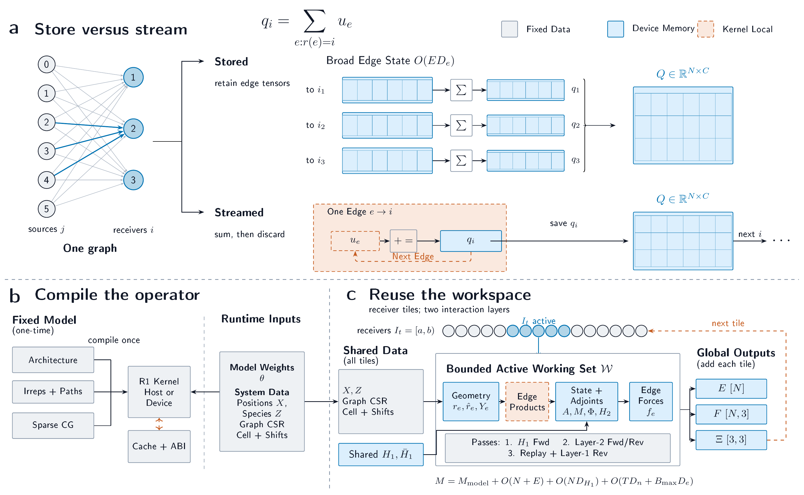

# Symmetrix-XL

[](https://github.com/bonan-group/symmetrix-xl/actions/workflows/ci.yaml?query=branch%3Amain)
[](https://bonan-group.github.io/symmetrix-xl/)
[](https://arxiv.org/abs/2610.01036)

In Symmetrix-XL, **XL** stands for **eXtreme scale, Low latency**.

Symmetrix-XL builds on [Symmetrix](https://github.com/wcwitt/symmetrix), a cross-platform evaluator for MACE models,
and extends it with scalable, low-latency native execution paths for CPUs and
GPUs. The Python distribution is named `symmetrix-xl`; the import namespace and
command-line interface remain `symmetrix`.

The methods, validation, and benchmark protocol are described in the preprint
[Train for Accuracy, Execute at Scale: Architecture-Preserving Inference for Equivariant Atomistic Foundation Models](https://arxiv.org/abs/2610.01036).

Symmetrix-XL preserves the MACE checkpoint's architecture and learned weights
while changing how its equivariant operations are scheduled, stored, and
compiled. Its execution strategy has three main components:

1. **Memory-bounded direct execution (a).** Streamed-edge execution avoids
   retaining broad graph-wide radial and tensor-product edge state by generating
   each contribution near its point of use, accumulating it into the
   corresponding receiver, and discarding kernel-local products.

2. **Model-specialized execution with runtime compilation (b).** Symmetrix-XL
   lowers the checkpoint's fixed sparse coupling structure, coefficients, and
   tensor layouts into generated CPU, CUDA, or HIP kernels and caches the
   resulting artifact. Learned model parameters and per-system graph and
   geometry data remain runtime inputs.

3. **Tiled execution with workspace reuse (c).** For capacity-limited
   calculations, optional tiled execution partitions receivers and their
   incident edges into bounded tiles and reuses a tile-local workspace across
   three sweeps. Inter-layer state remains graph-wide, while larger temporary
   intermediates are bounded by the active tile. Persistent outputs and
   inter-layer updates are committed before the workspace is reused.



See the [documentation](https://bonan-group.github.io/symmetrix-xl/) for
installation, supported workflows, and developer references.

The **frontend** is the Python package, ASE calculator, model-conversion tools,
and CLI that users interact with. A **backend** is the native CPU/OpenMP, CUDA,
or HIP extension that performs graph construction and model evaluation. The
frontend API is shared across backends, while accelerator packages are built for
specific device architectures. Pre-compiled pip packages are usually the
simplest choice: they avoid a local C++/Kokkos/CUDA or HIP toolchain build,
install a tested architecture-matched extension, and make environments easier
to reproduce. Build from source when no suitable wheel exists or when developing
the native implementation.

Official CPU and CUDA wheels also carry generated artifacts for the known MACE
contracts and OAM architectures. OAM lookup compares the exported model's
ordered layer count, channel/irrep widths, angular orders, tensor-product
instructions and masks, and radial-table dimensions with the catalog entry.
It does not select by model path or learned-weight hash. A custom architecture
that has no exact catalog match is generated at runtime when the matching
compiler is available.

### Demonstrated scale

The paper's FP32 single-GPU LAMMPS capacity benchmark uses the MACE-OMAT-0
medium checkpoint on cubic SrTiO3, with a 6.0 A model cutoff and a 0.5 A
neighbor-list skin:

| Execution | A100 80 GB atoms | RTX 5090 32 GB atoms |
|---|---:|---:|
| ML-IAP + cuEquivariance | 24,565 | 8,640 |
| Symmetrix-XL standard streaming | 1,250,235 | 486,680 |
| Symmetrix-XL tiled streaming | 11,240,455 | 4,152,920 |

Tiled streaming is an explicitly enabled capacity mode; standard streaming
remains the default. These values are the largest successful capacity-boundary
probes under the stated protocol, not general capacity guarantees or sustained
20-step molecular-dynamics results. On 64 A800 GPUs, tiled streaming weak-scaled
to 703.04 million atoms at 93.81% efficiency.

### Demonstrated speed

The Symmetrix-XL paper reports the matched performance study, including the
model, graph policy, hardware, warmup, and measurement protocol. Release
documentation does not reproduce timings from comparison packages; consult the
paper when evaluating performance claims.

-----

### Quick Start

Symmetrix-XL supports CPU/OpenMP, CUDA, and HIP through separately packaged
backends. For a normal installation, use the published wheels:

```bash
python -m pip install symmetrix-xl
```

The base `symmetrix-xl` package provides the Python frontend and an x86-64-v3
CPU/OpenMP backend. It is the required fallback package and needs AVX2, FMA,
and the other x86-64-v3 CPU features. A CPU-only machine needs no additional
backend package.

GPU packages are architecture-qualified and can be installed alongside the
base package. The selector contains the CUDA or ROCm major version and the
device target:

```bash
python -m pip install symmetrix-xl-cuda12-sm80   # NVIDIA, compute capability 8.0
python -m pip install symmetrix-xl-cuda13-sm120  # NVIDIA, compute capability 12.0
```

Only install a GPU package whose target matches the deployment device. GPU
packages depend on the matching `symmetrix-xl` frontend and retain the CPU
fallback; they do not overwrite another installed architecture. NVIDIA
packages provide the CUDA runtime dependencies through Python packages, but a
compatible NVIDIA driver is still required. Use `symmetrix backend list` and
`symmetrix doctor` to inspect and verify the selected backend.

The CLI can resolve and install a published matching GPU wheel automatically:

```bash
symmetrix backend install --arch auto
```

Use an explicit selector such as `--arch cuda13-sm120` on a headless or
multi-GPU host. Automatic selection reports its architecture and toolkit
resolution, and falls back from a missing CUDA 13 wheel to CUDA 12 when that
wheel is published. If no published wheel exists, the CLI prints a source-build
command.

### Source and custom builds

Start from a source checkout to build the CPU backend for the local machine or
to build a CUDA/HIP target that does not have a published wheel:

Source builds require Python 3.10 or newer, CMake 3.27 or newer, a C++20
compiler, a Fortran compiler, OpenBLAS or another compatible optimized BLAS,
and a recursive checkout. CUDA builds additionally require a matching CUDA
toolkit and `nvcc`; HIP builds require a matching ROCm toolkit and `hipcc`.
Keep CPU, CUDA, and HIP builds in separate environments and build directories.

```bash
git clone --recursive https://github.com/bonan-group/symmetrix-xl.git
cd symmetrix-xl
uv venv
source .venv/bin/activate
python tools/symmetrix_build.py install --backend cpu --cpu-target native
```

For example, detect the visible NVIDIA GPU architecture and install the
matching CUDA 13.3 backend:

```bash
python tools/symmetrix_build.py install --backend cuda \
    --cuda-root /usr/local/cuda-13.3
```

Detection requires exactly one visible CUDA architecture. If no GPU is visible
on the build host, or visible GPUs have different architectures, specify the
deployment target explicitly, for example `--arch sm120`.

On Apple silicon Macs, a source install builds an FP32 Apple GPU backend;
see [Apple Metal](docs/user/metal.md).

Inspect the installed backends and test the one selected for the current
machine:

```bash
symmetrix backend list
symmetrix doctor
```

### ASE calculator

After obtaining a compact JSON model, `Symmetrix` is a drop-in replacement for
the usual MACECalculator in ASE workflows:

```python
from ase.spacegroup import crystal
from symmetrix import Symmetrix

a = 3.905
atoms = crystal(
    symbols=["Sr", "Ti", "O"],
    basis=[(0, 0, 0), (0.5, 0.5, 0.5), (0.5, 0.5, 0)],
    spacegroup=221,
    cellpar=[a, a, a, 90, 90, 90],
)
atoms.calc = Symmetrix("mace-omat-0-medium.json")
print(atoms.get_potential_energy())
print(atoms.get_forces())
print(atoms.get_stress())
```

The calculator defaults to FP32 model evaluation with generated direct,
capacity-aware execution. Pass `dtype="float64"` explicitly for high-precision
calculations.

Convert a MACE checkpoint to the compact JSON format used by Symmetrix-XL. The
converter is optional; JSON-only evaluation does not require `mace-torch`.

```bash
uv pip install mace-torch
symmetrix_extract_mace \
    --model mace-omat-0-medium.model \
    --output mace-omat-0-medium.json
```

The default is the preferred universal compact export, retaining every element
supported by the checkpoint. Compact format v2 stores the shared radial model
once instead of generating pair-specific spline tables, while format v3 also
retains the complete checkpoint domain. Universal compact files therefore
avoid quadratic pair-table growth and can be reused across compositions; they
still include the checkpoint's element-indexed learned parameters. Element
selectors are intended only for deliberately restricted format-v2 deployments
or exports in the original Symmetrix pair-spline format (named v1 here);
format-v3 models reject subsets.

### NequIP-OAM (experimental)

Version 0.2.0 includes experimental native evaluation of exported NequIP-OAM
S/M/L/XL models through the OAM v2 JSON contract. It is not a general NequIP
graph compiler. Exporting an upstream package requires the optional reference
stack; evaluating the resulting JSON does not import PyTorch, NequIP, or e3nn:

```bash
python -m pip install "symmetrix-xl[nequip]"
symmetrix_extract_nequip \
    --model NequIP-OAM-S-0.1.nequip.zip \
    --output oam-s-nequip.json
```

```python
from symmetrix import NequIPCalculator

atoms.calc = NequIPCalculator("oam-s-nequip.json", dtype="float32")
```

Current host ABI-v7 and CUDA ABI-v3 `direct` artifacts use the
full-message-only generated path. Source generation supports FP32 and FP64,
but the fresh runtime release matrix and repaired-wheel gates remain pending.
HIP and multi-GPU execution are unsupported.
See the [model guide](docs/user/models.md#nequip-and-oam) for the
exact property and artifact boundaries, and the
[publication guide](docs/reference/publications.md#nequip-oam) for the NequIP
and OAM papers to cite.

CUDA and HIP backends are installed separately for a matching GPU architecture;
see the [installation guide](docs/user/installation.md) and [Symmetrix-XL
package README](symmetrix/README.md) for backend-specific builds.

### LAMMPS integration

See the `pair_symmetrix` [README](pair_symmetrix/README.md) for use from LAMMPS.

### Development Setup

Use `uv` to create a worktree-local environment and install the package with
its test dependencies. Reuse the environment and editable build directory for
source iterations:

```bash
test -x .venv/bin/python || uv venv .venv
source .venv/bin/activate
uv pip install scikit-build-core pybind11 ninja
source_fingerprint=$(python -c 'from pathlib import Path; from tools._symmetrix_build.source_provenance import symmetrix_source_fingerprint; print(symmetrix_source_fingerprint(Path.cwd()))')
uv pip install --no-build-isolation --reinstall-package symmetrix-xl \
  -e "./symmetrix[test]" \
  --config-setting="cmake.define.SYMMETRIX_BUILD_SOURCE_CONTENT_SHA256=$source_fingerprint"
```

Run Python formatting and lint checks with `uvx pre-commit run --all-files`.

### Citing Symmetrix-XL

If you use Symmetrix-XL, please cite:

* L. Fu, Z. Feng, Y. Li, H. Du, X. He, J. Wu, K. Bao, Y. Zhang, Z. Deng, Z. Lu, and B. Zhu, "Train for Accuracy, Execute at Scale: Architecture-Preserving Inference for Equivariant Atomistic Foundation Models," arXiv:2610.01036 (2026). [[arXiv]](https://arxiv.org/abs/2610.01036)

Also cite the method implemented by the model or correction and the publication
for the checkpoint used. The [publication and software citation
guide](docs/reference/publications.md) covers MACE, MACE-MH-1, MACELES,
MACE-POLAR-1, MACEField, NequIP-OAM, DFT-D2/D3 damping variants, FourierD3,
and the open-source numerical reference implementations used during
development. Follow the model package or model card when it requests further
model-specific citations.

```bibtex
@article{fu2026symmetrixxl,
  title   = {Train for Accuracy, Execute at Scale: Architecture-Preserving Inference for Equivariant Atomistic Foundation Models},
  author  = {Fu, Lei and Feng, Zihui and Li, Yongheng and Du, Hongwei and He, Xin and Wu, Junyi and Bao, Kejie and Zhang, Yueyu and Deng, Zeyu and Lu, Ziheng and Zhu, Bonan},
  journal = {arXiv preprint arXiv:2610.01036},
  year    = {2026}
}
```

Symmetrix-XL builds on the original Symmetrix project. The earliest `symmetrix`
results are reported in:
* D. P. Kovács, J. H. Moore, N. J. Browning, I. Batatia, J. T. Horton, Y. Pu, V. Kapil, W. C. Witt, I.-B. Magdău, D. J. Cole, G. Csányi, "MACE-OFF: Short-Range Transferable Machine Learning Force Fields for Organic Molecules", _Journal of the American Chemical Society_ **147**, 17598 (2025). [[arxiv]](https://arxiv.org/abs/2312.15211) [[journal]](https://doi.org/10.1021/jacs.4c07099)

MACE foundation models and implementations are described in:
* I. Batatia, P. Benner, Y. Chiang, A. M. Elena, D. P. Kovács, J. Riebesell, ...+78 others..., W. C. Witt, T. Wolf, F. Zills, G. Csányi, "A foundation model for atomistic materials chemistry," _Journal of Chemical Physics_ **163**, 184110 (2025). [[arxiv]](https://arxiv.org/abs/2401.00096) [[journal]](https://doi.org/10.1063/5.0297006)

Please also cite the model-specific references appropriate to the MACE checkpoint
you use.

### Licensing

The default license for this project is the [MIT License](./LICENSE).

The `pair_symmetrix` subdirectory, which enables integration with LAMMPS,
is licensed under the [GNU General Public License (GPLv2)](pair_symmetrix/LICENSE)
to maintain consistency with LAMMPS.

### Acknowledgements

Symmetrix-XL is based on [Symmetrix](https://github.com/wcwitt/symmetrix),
developed by William C. Witt.

The FourierD3 reciprocal-space DFT-D3 work builds on the method introduced by
V. Valeeva, C. H. Ho, M. Geiger, F. Pellegrini, G. Csányi, E. Kucukbenli, and
C. Ortner, "A fast summation method for the DFT-D3 dispersion correction,"
arXiv:2607.15103 (2026). [[arXiv]](https://arxiv.org/abs/2607.15103)

The original Symmetrix project also has the following acknowledgement statement:

An early phase of this project, leading to the Kokkos-based MACE implementation, was supported by the Schmidt Sciences Virtual Institute for Scientific Software (VISS). This engagement involved key contributions from Dave Brownell and Ketan Bhardwaj of the Center for Scientific and Software Engineering at Georgia Tech.
